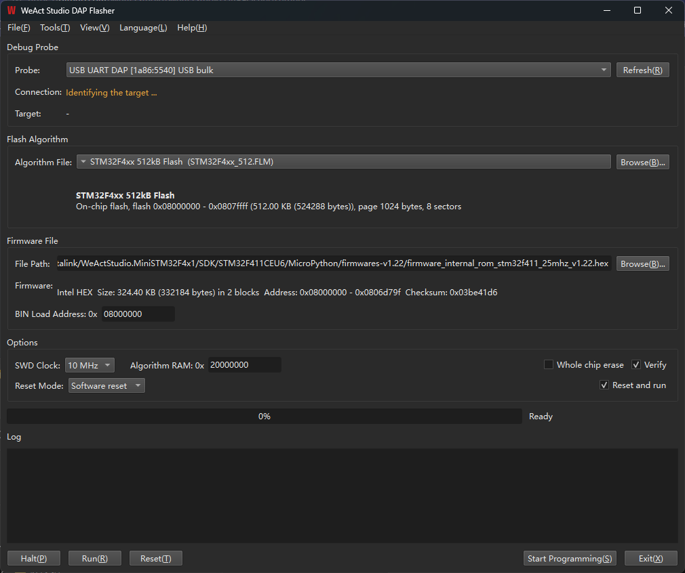

# WeAct Studio DAP Flasher

[简体中文](README_zh_CN.md)

A CMSIS-DAP flasher for Cortex-M targets, with both a graphical and a command line
front end. Flash algorithms are the Keil `.FLM` files you already have installed — no
conversion, no separate pack download.



## Features

- Enumerates probes automatically, both CMSIS-DAP v1 (USB HID) and v2 (USB bulk / WinUSB)
- Intel HEX and raw BIN firmware; size, address range, block count and checksum are
  shown as soon as a file is picked, or dropped onto the window
- Scans the local Keil installation and Packs for `.FLM` algorithms and shows the flash
  geometry (page size, sector count) of the one you load
- Optional whole-chip erase, verify after programming, software / hardware reset, and
  reset-and-run
- Halt / Run / Reset buttons drive the target at any time
- UI in English, Simplified Chinese, Russian, German and Spanish, following the system
  language or picked from the menu

## Quick start

GUI: plug in a probe, press **Refresh**, pick the algorithm and the firmware, then
**Start Programming**. A firmware file can also be dropped onto the window.

Command line (`WeAct Studio DAP Flasher CLI.exe`):

```bash
dapflasher --list                                        # list probes
dapflasher --identify                                    # read target information
dapflasher --firmware app.hex --algo STM32F4xx_512.FLM   # program, verify, reset and run
dapflasher --erase-chip --algo STM32F4xx_512.FLM         # erase only, to unbrick a target
```

See `dapflasher --help` for every option. Exit codes: `0` success, `1` failure,
`2` usage error.

## Download

Prebuilt packages are on the [Releases](https://github.com/WeActStudio/WeActStudio.DAPFlasher/releases)
page. Windows 10/11 64-bit, unzip and run, no runtime installation needed.

## Building from source

MSYS2 MINGW64, a static Qt (Qt5 or Qt6), hidapi and libusb are required:

```bash
pacman -S mingw-w64-x86_64-qt6-static mingw-w64-x86_64-hidapi mingw-w64-x86_64-libusb
./build.sh        # output in build/ and build-cli/
```

hidapi and libusb are linked statically, so the executables depend on no MSYS2
runtime DLL; copying the two `.exe` files anywhere is enough.

## License

Released under the **GNU General Public License v3.0**; the full text is in
[LICENSE](LICENSE).

Third-party libraries: libusb (LGPL-2.1) and HIDAPI (BSD-3-Clause / GPL-3.0 dual).
