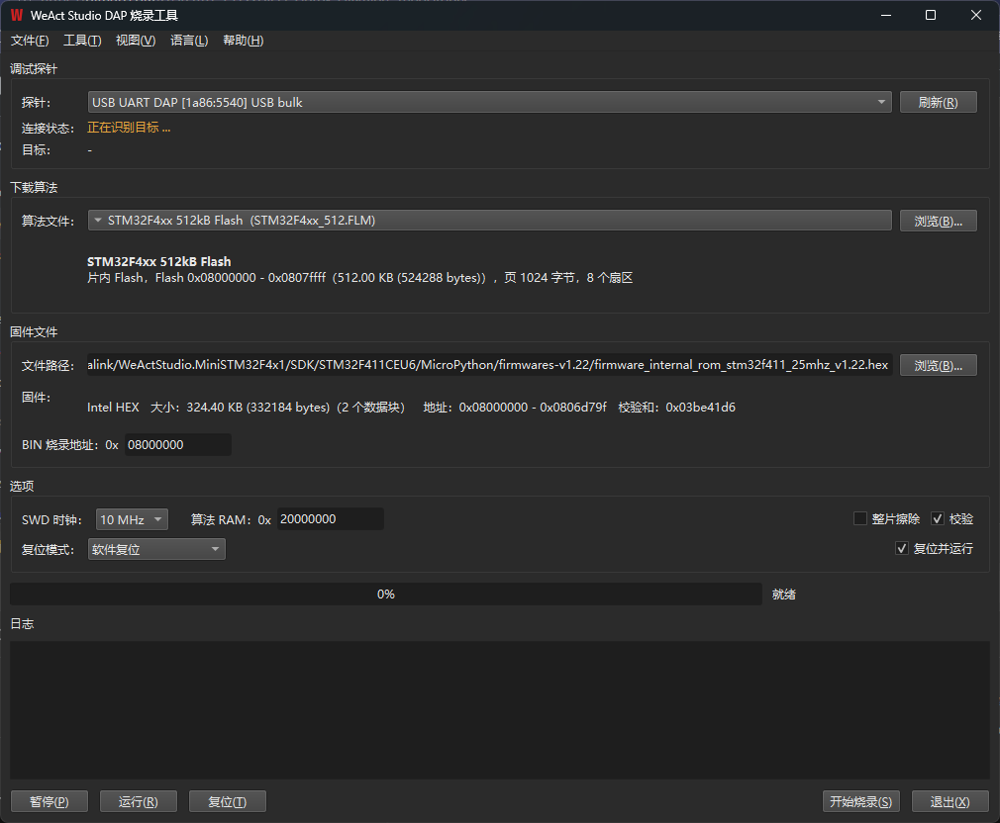

# WeAct Studio DAP Flasher

[English](README.md)

用 CMSIS-DAP 探针给 Cortex-M 芯片烧录固件的工具，图形界面 + 命令行双前端。烧写算法直接复用本机 Keil 的 `.FLM`，不需要转换或另外下载 pack。



## 功能

- 自动枚举探针，CMSIS-DAP v1（USB HID）与 v2（USB bulk / WinUSB）都支持
- 固件支持 Intel HEX 和原始 BIN，选完（或拖进窗口）即显示大小、地址范围、数据块数与校验和
- 自动扫描本机 Keil 安装目录和 Packs 里的 `.FLM`，加载后显示 Flash 几何（页大小、扇区数）
- 整片擦除、写后校验、软件/硬件复位、烧完直接运行，均可勾选
- 底部 Halt / Run / Reset 可随时控制目标芯片
- 界面支持简体中文、English、Русский、Deutsch、Español，可跟随系统

## 快速上手

图形界面：插上探针 → 点「刷新」→ 选算法和固件 → 点「开始烧录」。固件文件也可以直接拖进窗口。

命令行（`WeAct Studio DAP Flasher CLI.exe`）：

```bash
dapflasher --list                                        # 列出探针
dapflasher --identify                                    # 读目标芯片信息
dapflasher --firmware app.hex --algo STM32F4xx_512.FLM   # 烧录 + 校验 + 复位运行
dapflasher --erase-chip --algo STM32F4xx_512.FLM         # 只擦整片，用于救砖
```

全部参数见 `dapflasher --help`；退出码 `0` 成功、`1` 失败、`2` 参数错误。

## 下载

预编译包见 [Releases](https://github.com/WeActStudio/WeActStudio.DAPFlasher/releases)，Windows 10/11 64 位，解压即用，无需安装运行时。

## 从源码构建

需要 MSYS2 MINGW64、静态 Qt（Qt5/Qt6 均可）、hidapi、libusb：

```bash
pacman -S mingw-w64-x86_64-qt6-static mingw-w64-x86_64-hidapi mingw-w64-x86_64-libusb
./build.sh        # 产物在 build/ 和 build-cli/
```

hidapi 和 libusb 都按静态库链接进 exe，产物不依赖任何 MSYS2 运行时 DLL，两个 exe 拷到任意目录即可运行。

## 许可证

本项目以 **GNU General Public License v3.0** 发布，全文见 [LICENSE](LICENSE)。

用到的第三方库：libusb（LGPL-2.1）、HIDAPI（BSD-3-Clause / GPL-3.0 双许可）。
